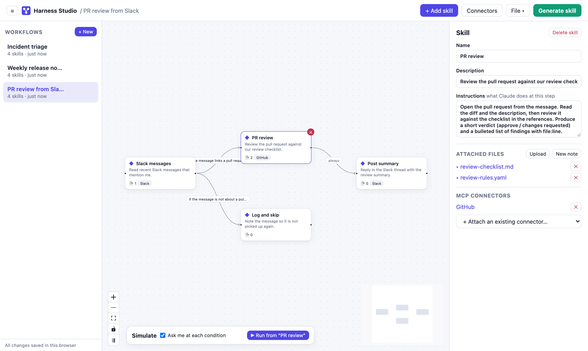
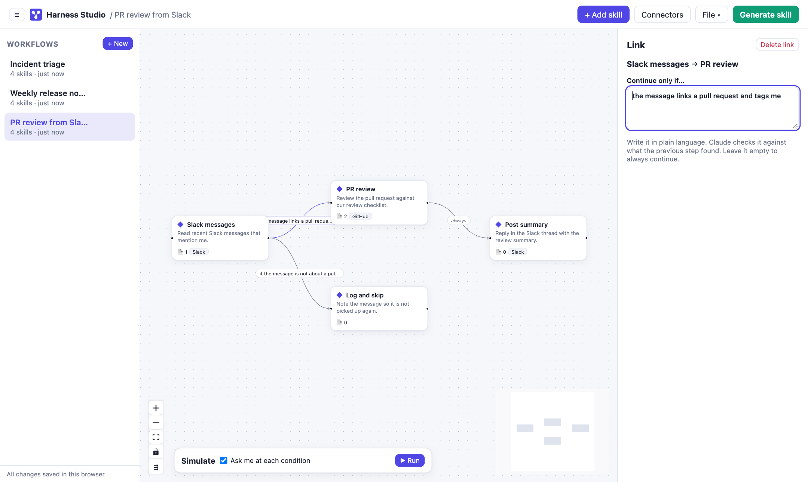
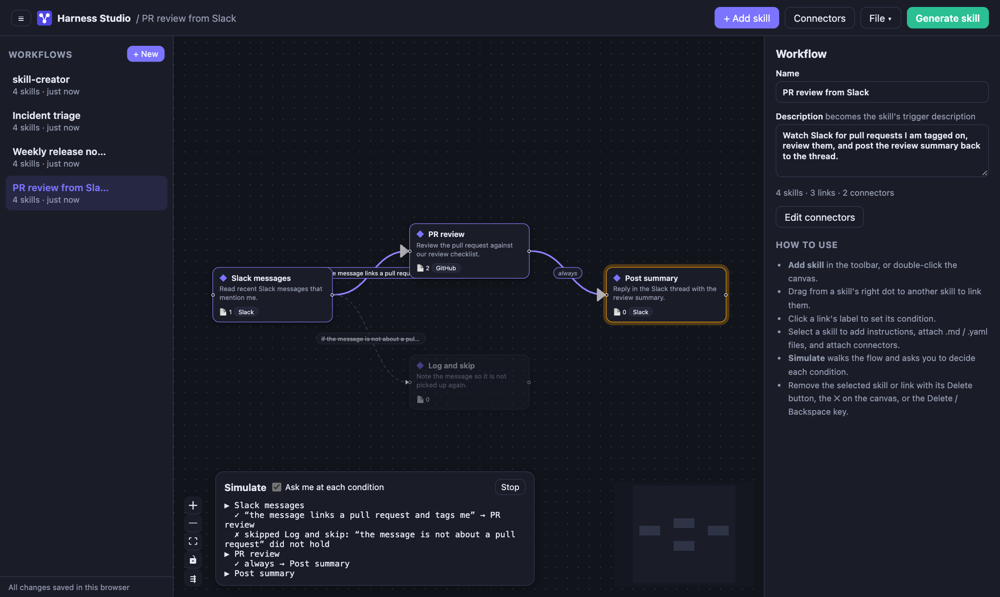
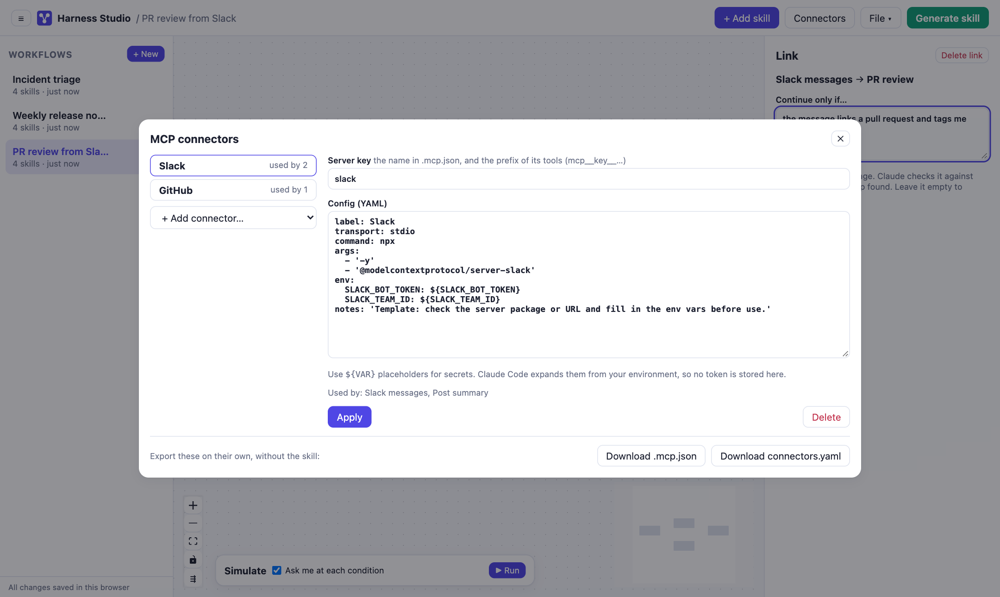
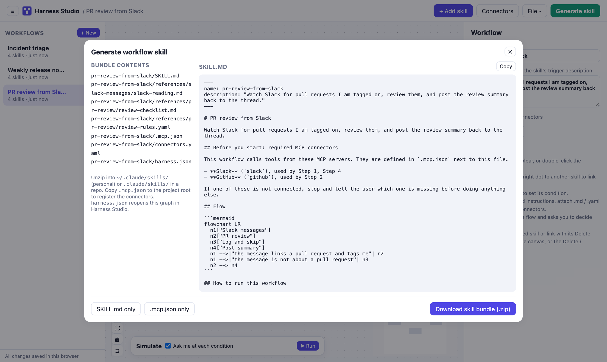
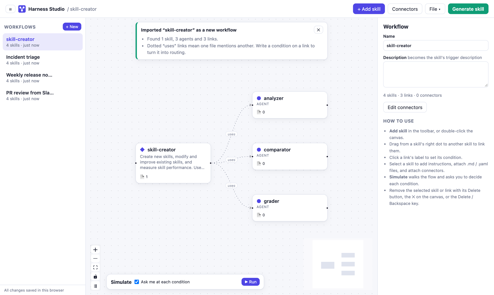

# Harness Studio

A visual designer for Claude Code workflow skills. Drop skills on a canvas, link them with
plain-language conditions, attach the reference files and MCP connectors each step needs,
dry-run the flow, then export a ready-to-install skill bundle.



## Run

```bash
npm install
npm run dev
```

Everything runs in the browser. There is no backend and nothing is sent anywhere.

## Tour

### Build a flow

- Add skills from the toolbar, or double-click the canvas.
- Drag from a skill's right dot to another skill to link them.
- Select a skill to write its instructions, attach `.md` / `.yaml` / `.txt` / `.json` files, and
  attach MCP connectors.
- Remove the selected skill or link with its Delete button, the ✕ on the canvas, or the
  Delete / Backspace key. Deleting a skill that has content asks first.
- **Tidy layout** (under the zoom controls, or in the File menu) lays the graph out left to right
  and wraps long flows into rows of five.

### Route with plain-language conditions

Click a link's label to say when the flow should take it. Claude checks the condition against what
the previous step found. A link with no condition always runs.



### Dry-run it

**Simulate** walks the flow from its start skills, or from the selected one. The active skill
pulses, a dot travels along each link, and with "Ask me at each condition" on it stops at every
condition for a Yes or No. Skipped links turn dashed and the log records the path taken.



### Connectors

A skill gets a "⚠ needs …" warning when it names a service (Slack, GitHub, Jira, Bitbucket and so
on) or references a tool like `mcp__slack__search` without that connector attached. Each connector
is edited as YAML, and `.mcp.json` or `connectors.yaml` can be downloaded on their own. Use
`${VAR}` placeholders for secrets; Claude Code fills them in from your environment.



### Generate the skill

**Generate skill** previews the `SKILL.md` and downloads a zip:

```
<workflow-name>/
  SKILL.md                 orchestrator: connectors, mermaid flow, steps with routing
  references/<skill>/…     files attached to each step
  .mcp.json                connectors in Claude Code's format
  connectors.yaml          the same, as YAML
  harness.json             reopen this graph in Harness Studio
```

Unzip it into `~/.claude/skills/` (personal) or `.claude/skills/` in a repo.



### Import existing skills

**File → Import skill folder…** or **Import skill .zip…** turns existing skills back into a graph,
always as a new workflow.

- A Harness Studio bundle reloads exactly from `harness.json`, or is rebuilt from its `SKILL.md`.
- A plugin (`.claude-plugin/plugin.json` with `skills/`, `agents/`, `commands/`), or a skill with
  its own `agents/`, becomes one node per skill, agent and command. Mentions such as
  `/plugin:name`, `skills/name/` or `` `agent-name` `` become dotted "uses" links; a mention on an
  "If …" / "When …" line becomes a condition.
- A single skill or command with numbered `## 1 · …` sections is split into a chain of steps.
- Files a skill links to (`$CLAUDE_PLUGIN_ROOT/…`, relative links) and the rest of its folder are
  attached. `.mcp.json`, `connectors.yaml` and `mcp__server__tool` references become connectors.
- Build output, binaries, files over 512 KB and secret-looking files (`.env`, keys, `*token*`) are
  never read.



### Many workflows

The left sidebar lists every saved workflow. Click to switch, double-click or ✎ to rename, ⧉ to
duplicate, ✕ to delete, **+ New** to start one. Names are kept unique.

## Where your work is saved

Workflows autosave to IndexedDB in this browser, and the last one you had open reopens next time.
The data stays in this browser profile, so use **File → Save harness.json** to move a workflow to
another browser or keep a copy elsewhere.

All persistence goes through the `WorkflowStorage` interface in `src/storage.ts`, so a local or
hosted backend can replace IndexedDB later without UI changes.

## Stack

Vite, React, TypeScript, [React Flow](https://reactflow.dev), Zustand, JSZip, js-yaml.
